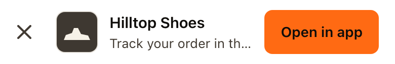
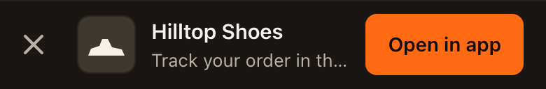

<!-- Header: the same in every Strait SDK README (design system v5). -->
<p align="center">
  <a href="https://straitlink.in">
    <picture>
      <source media="(prefers-color-scheme: dark)" srcset=".github/assets/strait-lockup-dark.svg">
      
    </picture>
  </a>
</p>

<h1 align="center">Strait SDK for the web</h1>

<p align="center"><strong>Straight to the screen. On the record.</strong><br>
A tap opens the exact screen, and every link open and install is recorded in your Strait dashboard.</p>

<p align="center">
  <a href="https://github.com/strait-link/strait-sdk-web/tags"></a>
  <a href="https://straitlink.in/platform-status/"></a>
  <a href="https://github.com/strait-link/strait-sdk-web/actions/workflows/ci.yml"></a>
  <a href="LICENSE"></a>
</p>

<p align="center">
  <a href="https://straitlink.in/docs/sdks/web/">Docs</a> ·
  <a href="https://straitlink.in/platform-status/">Platform status</a> ·
  <a href="CHANGELOG.md">Changelog</a> ·
  <a href="#docs-and-support">Talk to the Strait team</a>
</p>

`@straitlink/web`

Deep linking for the web: deferred match + attribution, in a few lines.

The device signature is kept in lockstep with the server and the other app SDKs via shared golden
vectors (this package runs the same vectors in CI), so a change that would make them drift fails the tests.

## Platform features

| Feature | Status | Notes |
|---|---|---|
| Web links open the right page | ● Live | Handled by Strait; nothing to install. |
| Deferred match on first visit (`resolveDeferredLink`) | ◐ Beta | At most once per browser. Never throws. |
| Smart app banner for mobile web (`banner`) | ◐ Beta | Styled with the Strait design system, light and dark. No requests of its own (apart from loading your `icon`), no cookies. [Docs](https://straitlink.in/docs/smart-banner/) |
| iPhone install matching | Opt-in | Off until you choose it; proven on iPhone simulators, the real-iPhone run waits on our App Store listing. Runs in your app through the native SDKs, not in this package. Your choice in Dashboard → Settings → iPhone installs: device matching, paste handoff, both or neither, read from Strait at runtime. Device matching is off by default. iPhone matches are labelled Estimated until measured. |
| Published on npm | ● Live | `npm install @straitlink/web` |

● Live · ◐ Beta · ○ Planned · – Not yet · Opt-in: off until you switch it on. The same words as the [platform status](https://straitlink.in/platform-status/) page.

## Install

<!-- brand:install -->
```sh
npm install @straitlink/web
```
<!-- /brand:install -->

## Use

On first launch, ask Strait whether this device recently clicked one of your
links — and route to the deferred destination:

```ts
import { resolveDeferredLink } from '@straitlink/web';

const result = await resolveDeferredLink({
  publishableKey: 'st_pub_live_…',    // Dashboard → Get started (safe in apps; never the secret key)
  endpoint: 'https://<your-handle>.strait.link', // your workspace's link domain
});

if (result.matched && result.longUrl) {
  router.navigate(result.longUrl); // land the user on the right screen
}
```

`resolveDeferredLink` runs **at most once per browser** (it records one install
server-side, and remembers that in `localStorage`; where storage is blocked it can
run again on a later visit). In a browser it doesn't throw: on any network or
server error it resolves to `{ matched: false, matchMethod: 'none' }`, so it's safe
to await on startup. A network error or non-2xx reply (say a 503 while the server
wakes up) doesn't count as the one run: the next visit asks again. Outside a browser (server rendering), pass `device` or don't
call it, because it reads `window.screen`.

When the matched tap carried a referral code, the result also has `referralCode`
(preview, not switched on yet; contract B21). It is absent otherwise.

### What it sends

The SDK collects coarse device fields (screen width, pixel ratio, the browser's
language tag such as `en-US`, timezone) and posts them to `/v1/match`; the server
uses only the first two letters of the language. The **server** adds the
IP it observes and computes the match signature — the client never sees or sends
an IP, and the signature is never used as a cross-app identity.

## Smart app banner (mobile web)

Show an "Open in app" bar to visitors on phones. The button is a plain link to your
Strait link, so the tap opens your app on the right screen, or the store with the
destination kept through the install.

```ts
import { Strait } from '@straitlink/web';

Strait.banner({
  link: 'https://<your-handle>.strait.link/app', // a Strait link (opened as is)
  title: 'Hilltop Shoes',
  subtitle: 'Track your order in the app',
  icon: '/icons/app-192.png',
  theme: 'auto',                                  // 'light' | 'dark' | 'auto'
});
```

It shows only on phones and tablets, never inside your own app (pass `inApp` or
`appUserAgent`), and stays hidden for 30 days after the visitor closes it
(`dismissDays`). It makes no requests of its own (apart from loading your `icon`)
and sets no cookies; closing it stores the time in `localStorage`. The only thing
recorded is the tap on the link. `dist/banner.js` has no imports, so you can also copy it
next to your pages and load it with `<script type="module">`.

### How it looks

The banner follows the Strait design system (v5) in both themes: a warm white bar on light pages and a
warm near-black bar (`#191613`) on dark ones, one orange button (`#FF6A13` with ink text, 6.8:1), a
2 px focus ring, 44 px tap targets on touch screens and no motion when the visitor asks for reduced
motion. `theme: 'auto'` follows the visitor's light / dark setting.

To match your own brand, pass `accent` (your button colour). The text on it is picked for contrast
(ink or white) unless you pass `accentText`.

Preview every option locally: `npm run build`, serve the repo root, open `examples/banner.html`
(add `?theme=dark`, `?position=bottom` or `?accent=%234A2C1D`).

| Light | Dark |
|---|---|
|  |  |

## API

| export | purpose |
|--------|---------|
| `resolveDeferredLink(config, opts?)` | the one call you need on launch |
| `banner(options)` / `Strait.banner(options)` | smart app banner for mobile web; returns `{ element, dismiss, remove }` or `null` when not shown |
| `computeSignature(inputs)` | the canonical signature (advanced/testing) |
| `h32(s)` | the canonical hash (advanced/testing) |

## Docs and support

- **Docs:** [straitlink.in/docs/sdks/web/](https://straitlink.in/docs/sdks/web/) · [platform status](https://straitlink.in/platform-status/) · [troubleshooting](https://straitlink.in/docs/troubleshooting/)
- **Talk to the Strait team:** [support@straitlink.in](mailto:support@straitlink.in) (replies within 1 working day, IST) or call +91 81218 61890.
- **Bugs and feature requests:** [open an issue](https://github.com/strait-link/strait-sdk-web/issues) on this repo.
- **Security:** never in a public issue. Write to security@straitlink.in (see [SECURITY.md](SECURITY.md)).
